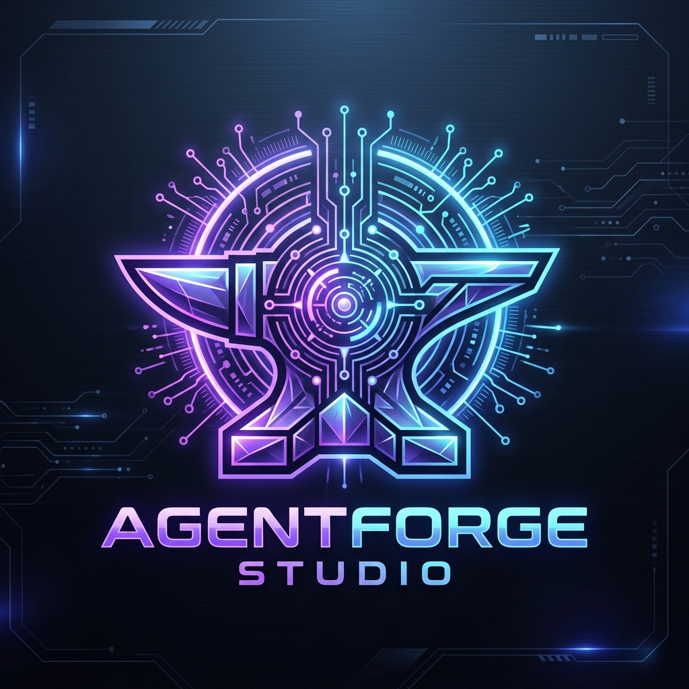
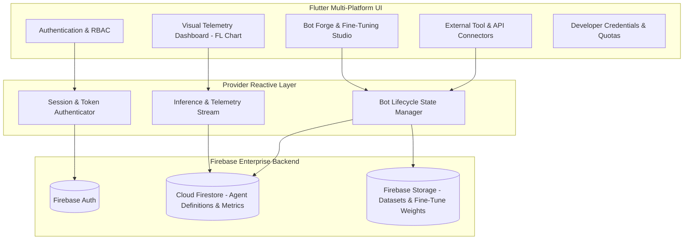

# 🤖 AgentForge Studio

<p align="center">
  
</p>

> **Autonomous AI Agent & Custom Bot Orchestration Studio** built with Flutter & Dart, featuring multi-agent workflow management, model training dashboards, real-time telemetry, and third-party API integration pipelines.

[](https://flutter.dev)
[](https://dart.dev)
[](https://firebase.google.com)
[](https://pub.dev/packages/provider)
[](https://pub.dev/packages/fl_chart)

---

## 📌 Executive Summary

**AgentForge Studio** is a multi-platform application designed for enterprise and developer workflows to build, configure, monitor, and deploy conversational and task-oriented AI agents. With an interactive visual dashboard powered by `fl_chart`, users can inspect model training loss curves, active token consumption, and agent invocation analytics in real time.

Built on reactive architecture using Flutter and Provider, AgentForge Studio seamlessly synchronizes bot states across web and mobile surfaces with Cloud Firestore and Firebase Storage.

---

## 🏗️ System Architecture



---

## ✨ Key Capabilities & Features

### 1. 🛠️ Agent Forge & Lifecycle Manager
- **Custom Agent Synthesis:** Define system prompts, temperature parameters, context window limits, and capability flags.
- **Dataset Ingestion:** Interactive file upload pipeline for prompt-response pairs and knowledge base grounding documents.
- **Agent Sandbox:** Live test-run environment to validate prompt behavior before production publishing.

### 2. 📊 Real-Time Telemetry & Visual Analytics
- **Live Loss & Convergence Graphs:** Powered by `fl_chart` with interactive tooltips and crosshairs.
- **Inference Quota Monitoring:** Tracks token throughput, latency percentiles, and active execution budgets.
- **Agent Health Status:** Automated heartbeats and error categorization across distributed endpoints.

### 3. 🔌 Extensible Integrations Hub
- **Webhook & REST Connector Pipeline:** Register external API webhooks for agent tool calling.
- **Secure Key Management:** Client-side obfuscation with encrypted cloud credential persistence.
- **Multi-Tenant Sharing:** Share fine-tuned agents with team workspaces or publish to the internal catalog.

### 4. 🌐 Internationalization & Accessibility
- Native multi-language support configured via `l10n` (`intl` package) for global deployment.
- High-contrast visual tokens and fluid responsive design scaling from mobile to 4K desktop viewports.

---

## 💻 Tech Stack & Dependencies

| Layer | Technologies |
| :--- | :--- |
| **Frontend Framework** | Flutter SDK (Material 3 Adaptive Design) |
| **Language** | Dart 3.x (Sound Null Safety) |
| **State Management** | `provider: ^6.1.0` |
| **Cloud Services** | `firebase_core`, `firebase_auth`, `cloud_firestore`, `firebase_storage` |
| **Visual Charts** | `fl_chart: ^0.68.0` |
| **Typography & UI** | `google_fonts: ^6.1.0`, `cupertino_icons: ^1.0.8` |
| **Asset & File System** | `file_picker: ^8.0.0` |
| **Localization** | `flutter_localizations`, `intl: ^0.20.2` |

---

## 🚀 Getting Started

### Prerequisites
- [Flutter SDK](https://docs.flutter.dev/get-started/install) (`>= 3.9.0`)
- A Firebase project with Firestore and Authentication enabled

### Setup Instructions
```bash
# Clone the repository
git clone https://github.com/itismemuhammadali/AgentForge-Studio.git
cd AgentForge-Studio

# Copy environment template
cp .env.example .env

# Run on your target platform
flutter run -d chrome      # Web
flutter run -d macos       # Desktop macOS
flutter run -d android     # Android Device/Emulator
```

---

## 👤 Author

- **Muhammad Ali**
  - **GitHub:** [@itismemuhammadali](https://github.com/itismemuhammadali)
  - **Portfolio:** [Portfolio Showcase](https://github.com/itismemuhammadali)
